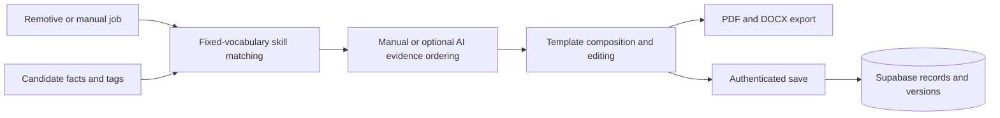

# Rolecraft

A job search workspace with Remotive discovery, editable candidate evidence, transparent skill matching, factual resume and cover-letter drafts, PDF/DOCX exports and private application tracking.

Status: implementation under verification. No verified public deployment yet. Live AI and private sync require server credentials and authentication-provider setup. Do not treat this as a completed production release.


## Contents

[Run on Windows](#run-on-windows) · [Services and configuration](#services-and-configuration) · [Honest coverage and privacy](#honest-coverage-and-privacy) · [Limits](#limits) · [Verification](#verification) · [Official references](#official-references) · [Technical documentation and attribution](#technical-documentation-and-attribution) · [From a vacancy to a reviewable application document](#from-a-vacancy-to-a-reviewable-application-document)

## Run on Windows

1. Install Node.js 24 LTS from https://nodejs.org (includes npm).
2. Open PowerShell in this folder.
3. Run:

```powershell
npm.cmd ci
Copy-Item .env.example .env.local
npm.cmd run dev
```

Open http://127.0.0.1:3000. The prepared synthetic example, manual profile, matching, editing and local document exports work without cloud credentials. Jobs, saved data and live AI need setup below. Do not overwrite an already configured .env.local.

For a production build:

```powershell
npm.cmd test
npm.cmd run typecheck
npm.cmd run build
npm.cmd start
```

## Services and configuration

Next.js runs the interface and server routes on Vercel Hobby (personal/noncommercial portfolio use). Supabase Free supplies Postgres and Auth. Run supabase/schema.sql once in a new project SQL Editor. It creates private ownership policies, immutable document versions, deletion functions and atomic usage counters. The existing project's actual region is Ireland, eu-west-1.

Put SUPABASE_URL, SUPABASE_ANON_KEY, SUPABASE_SERVICE_ROLE_KEY and GEMINI_API_KEY in .env.local for local development, and Vercel server environment settings for hosting. These names deliberately have no NEXT_PUBLIC prefix. Never commit .env.local or paste secrets in chat. The service-role key is used only for shared job cache and quotas; private records use the signed-in user's token and database policies.

GitHub sign-in uses Supabase PKCE and short-lived HttpOnly proof cookies. Configure a GitHub OAuth application with callback https://YOUR-PROJECT.supabase.co/auth/v1/callback, enter its client ID/secret in Supabase Authentication → Providers → GitHub, and allow the site's /api/auth/callback URL in Supabase Redirect URLs. Also allow http://127.0.0.1:3000/api/auth/callback for local use. Users must approve GitHub's identity grant themselves. Public pages need no account. Existing email accounts can sign in; public email signup is disabled unless EMAIL_SIGNUP_ENABLED=true and working custom SMTP is configured. Supabase's default email service is restricted and is not a public signup solution.

Use only a Gemini project with no billing and free quota for gemini-2.5-flash-lite. Set GEMINI_FREE_TIER_CONFIRMED=true after checking AI Studio. LOCAL_AI_COUNTRY=IN permits local India testing; production uses Vercel's country header. AI is restricted to adults in India. There is no paid fallback or automatic retry.

## coverage and privacy

Remotive is the only connected job source. Its public API is attributed and original source links are shown. A shared six-hour refresh claim limits upstream requests to at most four per day. Page opening and Refresh check that shared cache. Source listings are delayed by 24 hours. A sampled live feed returned 12 listings and no Mumbai Product Intern listing; this is not complete local-market coverage. Remote eligibility must be checked at the source. Manual job descriptions are always available.

The AI receives fixed vocabulary skills and temporary numbered evidence IDs only. It ranks evidence, then templates assemble documents using the candidate's exact statements. Raw resume text, names, contacts, employers and job descriptions are excluded from model requests. Google unpaid-service content may be reviewed and used for product improvement. Drafts require review. Skill overlap is an exact-tag heuristic, not an ATS score or hiring probability.

Uploads go to the application server for extraction and are not saved as files. Only explicitly saved profiles, applications and document text are stored. Guest edits live in tab memory and can be lost on navigation/sign-in. Deletion removes active application records; provider logs, backups and downloaded files are outside that deletion. The sign-in account remains.

## Limits

- AI: 3 attempts/user/day, 10 app-wide/day and 1/minute app-wide; UTC daily reset. Failed attempts count. Provider quota may be lower.
- Extraction/export: each 20/hour per network address and 200/day overall.
- Saved items: 100 applications and 100 document versions per user.
- Uploads: PDF/DOCX only, 3 MB, PDF ≤30 pages, extracted text ≤30,000 characters. Scanned files require manual entry; OCR is not included.
- PDF uses bundled Noto Sans. Unsupported glyphs produce an explicit error; DOCX preserves those characters. No guaranteed ATS compatibility.
- Supabase Free currently includes 500 MB database, 50,000 MAU and may pause after a week of inactivity. Free service availability and quotas can change.

## Verification

14 automated tests pass: payload privacy, exact evidence preservation, matching, safe links, source normalization/deduplication, location filtering, DOCX roundtrip, PDF text/pagination, invalid/scanned/oversized upload handling and archive-expansion rejection. TypeScript passes. The latest production build passes. PDF samples were visually inspected. Live AI, public deployed navigation, two-browser sync, cross-user isolation and deployed deletion remain unverified.

## Official references

- https://remotive.com/remote-jobs/api
- https://github.com/remotive-com/remote-jobs-api
- https://ai.google.dev/gemini-api/docs/pricing
- https://ai.google.dev/gemini-api/terms
- https://supabase.com/pricing
- https://supabase.com/docs/guides/auth/social-login/auth-github
- https://supabase.com/docs/guides/auth/sessions/pkce-flow
- https://vercel.com/docs/plans/hobby


## Technical documentation and attribution

See the [technical report](docs/TECHNICAL_REPORT.md) for architecture, evaluation scope, and current verification. Maintained in Aditya Hambire's repository; preserve existing Git history and third-party attribution. Repository ownership does not establish sole authorship.

Current checks and unresolved prerequisites: [verification record](docs/VERIFICATION.md).

## From a vacancy to a reviewable application document

Job descriptions, candidate evidence and application status are often kept in separate places. This workspace joins them around a single task. A user discovers or enters a role, checks which recognized skills have supporting facts, edits a draft assembled from those facts, exports it, and optionally saves the application privately.



### Matching and evidence preservation

`lib/domain.ts::tagsFor` recognizes a fixed vocabulary using word boundaries. `match` compares recognized job tags with the union of candidate fact tags and returns matched tags, gaps, supporting facts and a rounded percentage. If the job has no recognized tags, the score is null. Readers can inspect the denominator and supporting statements instead of relying on a score alone.

`aiPayload` sends requirement tags and numbered evidence/tag pairs. `compose` deduplicates valid ordering IDs and then appends all remaining candidate facts. It groups exact factual blocks under document sections and uses relevant facts in a cover-letter template. This design gives AI ordering a bounded role while the user remains responsible for wording, relevance and the final application.

### Discovery, exports and persistence

`lib/jobs.ts::normalizeRemotive` checks source links, normalizes dates, strips HTML, limits description length and deduplicates company/title/location combinations. Filtering combines role words with location and an explicit remote option. Those rules determine which vacancies appear and should be considered when interpreting a small result set.

Document handling uses PDF/DOCX extraction and local export libraries, with size and archive-expansion bounds. Supabase policies and signed-in user tokens govern saved private records. The SQL schema retains document versions, giving a saved application a concrete document history instead of silently replacing prior text.

### Demonstrated outcome

The 1 November verification record reports 14 passing tests, a passing TypeScript check and a completed production build. Tests exercise payload privacy, factual preservation, matching, source normalization, export roundtrips and malformed inputs. These establish the local document and matching workflow. Live authentication, synchronization and provider paths require their separately configured services.

### Source guide

```text
app/page.tsx                 interactive workspace
app/api/[...path]/route.ts   server entry points
lib/domain.ts               schemas, skills, matching and composition
lib/jobs.ts                 source normalization and filtering
lib/documents.ts            extraction and document exports
lib/server.ts               auth, quotas, provider and persistence
supabase/schema.sql         records, ownership policies and versions
tests/                      domain, source and document checks
```

A labeled set of job descriptions and candidate facts would help evaluate missed skill synonyms and relevance ordering. Deployed cross-user tests would extend the existing local evidence to the private save/delete workflow.
